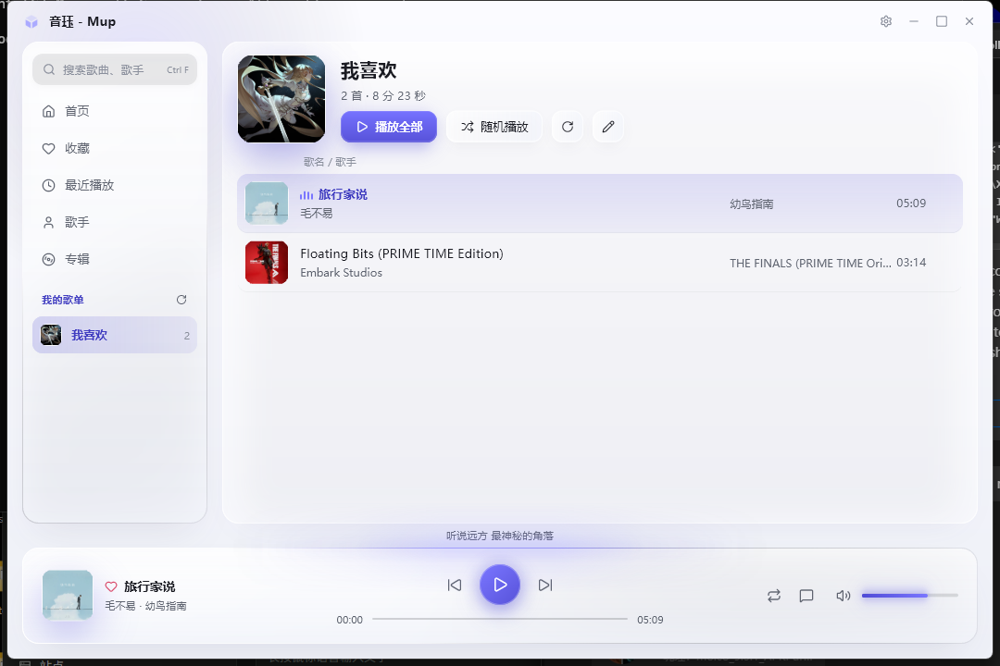

# 音珏 - Mup

通过 **Subsonic / OpenSubsonic** 连接飞牛音乐的轻量 Windows 音乐播放器。
当前版本使用 Flutter 原生桌面界面，通过 **音桥（Yinqiao）** 将飞牛音乐服务
转换为 Subsonic 协议后接入，不直接调用飞牛官方 API。

当前版本：**v0.4.1 Flutter**

本项目是公开的开源与提示词记录项目。旧版 PySide6/Qt 界面保留在
[`v0.3.13`](https://github.com/AndyXFuture/Mup/tree/v0.3.13) 标签中；
`main` 分支展示当前 Flutter 实现。

## 界面预览

| 曲库深色 | 曲库浅色 |
| --- | --- |
|  |  |

| 沉浸播放深色 | 沉浸播放浅色 |
| --- | --- |
|  |  |

更多截图：

- [设置页深色](docs/settings-dark.png)
- [设置页浅色](docs/settings-light.png)
- [歌手页](docs/artists-dark.png)
- [连接服务器页](docs/connect-window.png)

公开截图使用固定的示例数据，不包含真实服务器、账号或听歌记录。

## 特性

- 🎨 **Flutter 原生 UI**：冷调渐变背景、半透明面板、收敛亮边与柔和辉光。
- 🌗 **深浅主题**：支持跟随系统、浅色和深色模式。
- 🗂 **完整曲库导航**：歌单、收藏、最近播放、歌手、专辑和搜索。
- 📥 **完整歌单补全**：音桥返回的 Subsonic 歌单不足时，使用 Jellyfin 协议分页补全。
- 🎧 **播放控制**：播放/暂停、上一曲/下一曲、进度拖动、音量调节和静音恢复。
- 🔀 **四种播放模式**：列表循环、随机播放、单曲循环和顺序播放。
- 🎤 **同步歌词**：时间轴歌词、沉浸页滚动高亮和曲库页居中迷你歌词。
- 🖼 **沉浸播放页**：左右 50% 分栏、大封面柔光、歌词左对齐。
- 📊 **歌手排序**：从完整音频库统计曲目，包含合作曲，按歌曲数降序排列。
- 🪟 **原生窗口体验**：位置/尺寸恢复、双击标题栏最大化、最大化时拖动还原。
- 📌 **托盘常驻**：关闭窗口后继续播放，托盘菜单可恢复或退出。
- ⌨️ **全局媒体键**：窗口隐藏后仍支持播放/暂停、上一曲和下一曲。
- 🚀 **开机自启**：使用当前用户注册表启动项，无需管理员权限。
- 🔒 **单实例**：重复启动会唤回已有窗口，不会产生多个播放器进程。

## 下载

从 GitHub Releases 下载 v0.4.1：

`Mup-Flutter-v0.4.1-windows-x64.zip`

完整解压后运行 `Mup-v0.4.1.exe`。

> Flutter Windows 使用目录式发布包，不能只复制 exe。`data/`、
> `flutter_windows.dll` 和同目录插件 DLL 都是运行必需文件。

## 连接音桥

1. 在飞牛 NAS 上安装
   [音桥 fn-music-bridge](https://github.com/qianlipp/fn-music-bridge/releases)。
2. 开启 Subsonic / OpenSubsonic 协议并记录端口。
3. 首次启动填写服务器地址、端口（默认 `14040`）、用户名和密码。
4. 连接成功后配置会自动保存，下次启动直接进入曲库。

## 快捷键

| 功能 | 默认快捷键 | 系统媒体键 |
| --- | --- | --- |
| 播放 / 暂停 | `Ctrl+Alt+P` | 播放/暂停键 |
| 下一曲 | `Ctrl+Alt+→` | 下一曲键 |
| 上一曲 | `Ctrl+Alt+←` | 上一曲键 |
| 应用音量 | 播放栏音量滑块 | 不拦截，系统音量键交给 Windows |

## 开发

环境要求：

- Windows 10/11 x64
- Flutter `3.47.7` stable
- Dart `3.13.5`
- Visual Studio 2022，包含“使用 C++ 的桌面开发”工作负载

```powershell
git clone https://github.com/AndyXFuture/Mup.git
cd Mup
flutter pub get
flutter analyze
flutter test
flutter run -d windows
```

构建 Release：

```powershell
.\tool\build-release.ps1 -Version 0.4.1 -BuildNumber 1
```

产物位于 `release/`。完整构建说明见
[`使用方法.txt`](使用方法.txt)。

## 技术栈

Flutter · Dart · Just Audio · Windows SMTC 媒体键 · Win32 · Subsonic ·
OpenSubsonic · Jellyfin · Lucide Icons

## 项目结构

```text
lib/
  core/        配置、协议客户端、播放队列和 Windows 集成
  ui/
    components/ 玻璃面板、按钮、封面等基础控件
    pages/      曲库、播放、设置、连接页
    widgets/    侧边栏与播放栏
windows/runner/ 窗口、单实例、托盘和全局媒体键
tool/           构建与脱敏截图脚本
docs/           验收截图与视觉参考
```

## 隐私

- `config.json`、日志、封面缓存、音频缓存和构建产物不会提交。
- 服务器参数只保存在当前用户的本地配置目录。
- 公开截图通过 `--demo` 模式生成，不读取真实账号或音乐库。

详细实现见 [项目细节描述.md](项目细节描述.md)，版本历史见
[更新日志.md](更新日志.md)，开发提示词见 [提示词记录.txt](提示词记录.txt)。

## 致谢

- [音桥 fn-music-bridge](https://github.com/qianlipp/fn-music-bridge)
- [Subsonic API](http://www.subsonic.org/pages/api.jsp)
- [Lucide Icons](https://lucide.dev/)

## License

MIT License
